# How to play The Insider

A complete guide in plain words: what the game is, every mode, every screen, and every key. You don't need to know Linux or security first. The game teaches you as you go, and this guide explains the words you'll meet ([list at the end](#14-words-you-will-meet)).

> **Everything is pretend.** The office, its computers and its network exist only inside the game. No real command runs, and no real computer or network is touched. What you learn is real: the logs, the commands and the way investigators think.

---

## Contents

1. [The game in one minute](#1-the-game-in-one-minute)
2. [Starting the game](#2-starting-the-game)
3. [The home screen](#3-the-home-screen)
4. [Which mode should I play?](#4-which-mode-should-i-play)
5. [Your first minutes in the office](#5-your-first-minutes-in-the-office)
6. [Using a PC](#6-using-a-pc)
7. [Playing as a defender](#7-playing-as-a-defender)
8. [Meetings and voting](#8-meetings-and-voting)
9. [Playing as the hacker](#9-playing-as-the-hacker)
10. [Every mode in detail](#10-every-mode-in-detail)
11. [After the match](#11-after-the-match)
12. [Points, ranks and jackets](#12-points-ranks-and-jackets)
13. [All the keys](#13-all-the-keys)
14. [Words you will meet](#14-words-you-will-meet)
15. [Questions and problems](#15-questions-and-problems)

---

## 1. The game in one minute

You work at **Nexora**, a small company. Everybody has a desk, a badge for the doors, and a PC.

One of your colleagues is secretly a **hacker**. They want one file from the company's most important computer, the admin server (`ADMIN-SRV-01`). Only the administrator may read that file, so the hacker has to find a way in: a guessed password, a colleague's PC left open, an old note with a password in it.

Everything anybody does leaves **traces**: a line in a log file, a tap of a badge at a door, a picture on a camera. That's how the hacker gets caught.

There are two sides:

| | **Defenders** (almost everybody) | **The hacker** (one, sometimes more) |
|---|---|---|
| Goal | Find out who the hacker is, prove it, and vote them out | Get the file and hand it in without being caught |
| How | Read logs, follow the clues from an address to a PC and from a PC to a person, watch the cameras, collect evidence, call a meeting | Look like a normal employee, find a weak spot, read the file, wait a few minutes, hand it in |
| Win | The hacker is voted out at a meeting, or the security guard detains them | The file is handed in, or the defenders make too many mistakes (see [right or wrong](#right-or-wrong)) |

Colleagues you don't play are played by the computer (**bots**). They walk, work, take coffee breaks, notice things and vote. On the screen nobody can tell a bot from a person.

---

## 2. Starting the game

You need [Node.js](https://nodejs.org) (version 20 or newer). In a terminal, in the game's folder:

```powershell
corepack pnpm install
```

```powershell
corepack pnpm dev
```

Then open **http://localhost:5173** in Chrome, Edge or Firefox.

To play with friends on other computers in your home, start it with `corepack pnpm start` instead. The step-by-step guide is [docs/play-with-friends.md](docs/play-with-friends.md).

---

## 3. The home screen

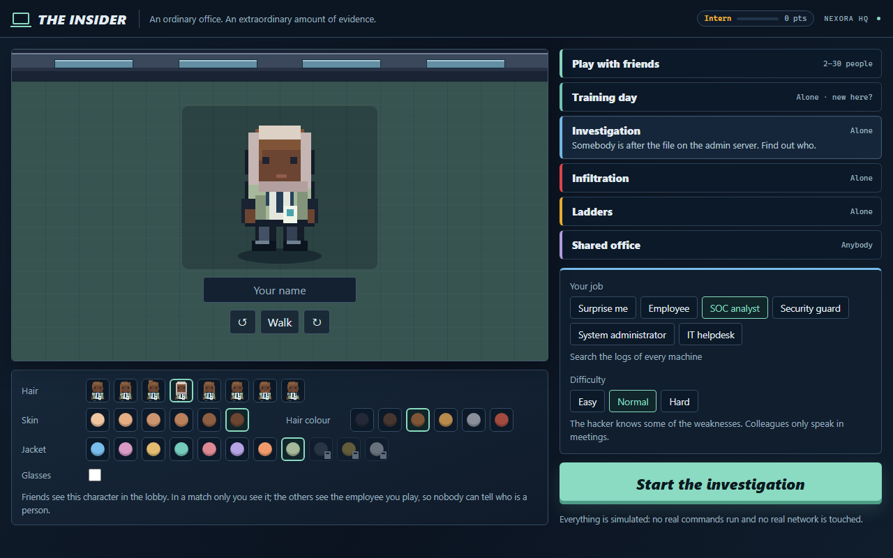

*The home screen. Left: your character and its clothes. Right: the ways to play, with the options of the chosen one and the big button that starts it.*

**On the left: your character.**

- Type your **name** under the character (friends see it in the lobby).
- The **wardrobe** underneath changes hair, skin, hair colour, jacket and glasses. **↺ ↻** turn the character and **Walk** shows it walking.
- Jackets with a small lock come with a rank (see [section 12](#12-points-ranks-and-jackets)).
- Friends see your character in the lobby. During a match only *you* see it: everybody else sees the employee you play, so nobody can tell people from bots.

**On the right: the ways to play.** Click one to see its options, then press the big button at the bottom. Each one is explained in [section 10](#10-every-mode-in-detail).

**At the top right: your rank** and points (for example *Intern · 0 pts*). Hold the mouse over it to see your matches, wins, and how far it is to the next rank.

If you closed the page during a match, a line at the top offers to take you **back to it**.

---

## 4. Which mode should I play?

| If you… | Play | Alone? |
|---|---|---|
| are new | **Training day**: a colleague shows you every step | alone, with bots |
| want to learn to investigate, one skill at a time | **Ladders → Defender ladder** | alone |
| want a full case as a defender, with a job you pick | **Investigation** | alone |
| want to be the hacker | **Infiltration**, or **Ladders → Hacker ladder** | alone |
| have friends around | **Play with friends** | 2–30 people |
| want to walk in and see who's there | **Shared office** | anybody |

**The best order for a beginner:** Training day → Defender ladder, cases 1 to 5 → Investigation on Easy → Play with friends.

---

## 5. Your first minutes in the office

### The screen

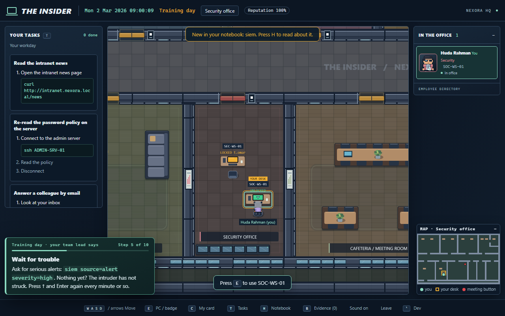

*The office. Your own desk has an amber frame and says YOUR DESK.*

| Where | What it shows |
|---|---|
| **Top bar** | the game's clock (game time, not your clock), the mode, the room you're in, and the company's **reputation** (it starts at 100 %) |
| **Left: Your tasks** (`T`) | your work for today. Doing it is how a good employee (or a careful hacker) looks normal |
| **Middle** | the office, seen from above. You're the person labelled *(you)* |
| **Right: In the office** | everybody at work, their department, their PC, and whether they're in |
| **Bottom right: the map** | the whole office, **you** (green), **your desk** (amber) and the **meeting button** (red). It never shows other people. `−` folds it away |
| **Bottom bar** | the most useful keys, the **Sound on** switch and **Leave** |

**The colours of the screens** on the desks tell you something:

| Screen colour | Means |
|---|---|
| green, *UNLOCKED* | somebody is logged in and the PC is open: anybody who sits down can use it |
| amber, *LOCKED* with a username | somebody is logged in, but the screen is locked |
| grey, *LOGIN* | nobody is logged in |

### Your card

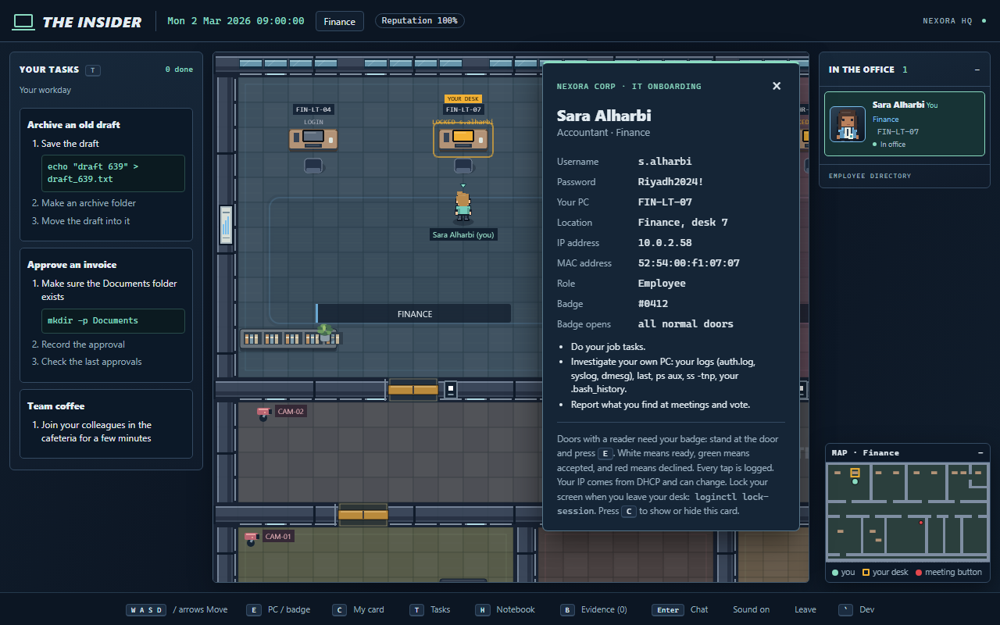

*The onboarding card. Press `C` to show or hide it.*

Your card is the first thing you see. It has:

- your **username** and **password** (you need them to log in),
- **your PC** and where it stands,
- your PC's **IP address** and **MAC address** (its addresses on the network),
- your **role** (your job) and what it lets you do,
- your **badge** number and which doors it opens.

Nobody else can see your card. Press `C` to put it away and `C` again to bring it back.

### Walking and doors

- Walk with `W` `A` `S` `D` or the **arrow keys**.
- Doors with a small box next to them have a **badge reader**. Stand at the door and press `E` to tap your badge. The light shows **white** (ready), **green** (welcome) or **red** (your badge isn't allowed there).
- Dark red doors open only for certain badges (the server room, the security office).
- **Every tap is written down** (in the badge log on `SEC-SRV-01`), whether the door opened or not. Walking in right behind somebody else without tapping is possible at some doors, but cameras may see it.

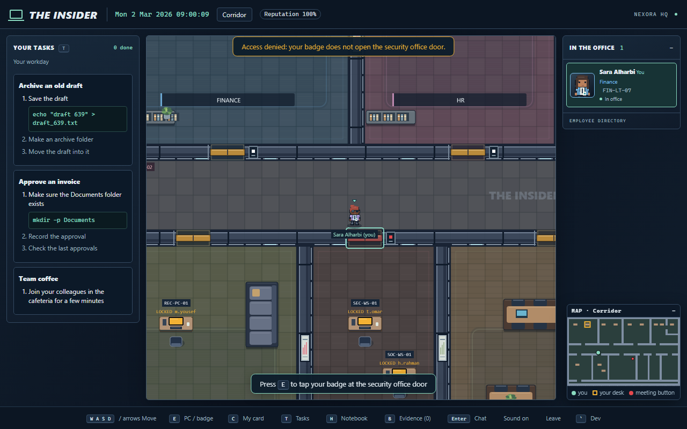

*A red light: this badge isn't allowed through this door. The attempt is logged anyway.*

### Talking

In the **shared office** and in **matches with friends**, press `Enter` to chat. Only people in the **same room** hear you (in a doorway, those within a few steps). During a meeting everybody hears everybody.

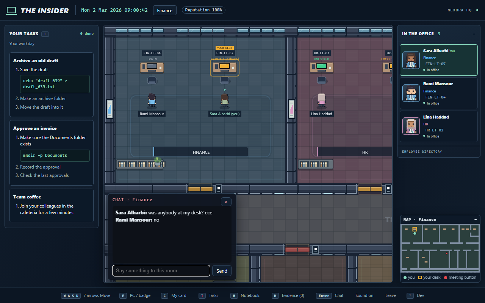

*Open chat: only the people in the same room read it.*

### Sounds

The game makes small sounds: a badge beep, an alarm when a security alert appears, a bell for meetings, a quiet office hum. **Sound on** in the bottom bar switches all of them off (and on again). The game remembers your choice.

---

## 6. Using a PC

### Sitting down and logging in

Walk to a desk, stand at the chair and press `E`. What you see depends on the PC:

| The PC shows | What you can do |
|---|---|
| **a login prompt** | type a username, `Enter`, then the password, `Enter` |
| **a lock screen** | type the password of the user who locked it. Or press `F2` to **switch user**: log in as yourself, while the locked session stays underneath |
| **a shell** (the PC is open) | you're now working *as whoever is logged in there*. Every command you type is written down under *their* name |

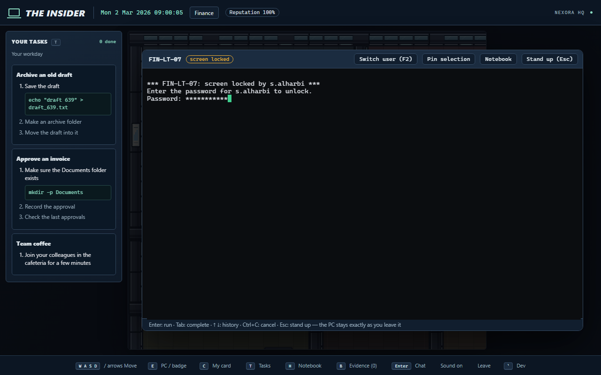

*A locked PC. Only its user's password opens it, or F2 to log in as somebody else beside it.*

When you type a password you see stars. That's normal: anybody looking over your shoulder sees only the stars (although someone standing right behind you may still catch a few letters as you type).

Press `Esc` to **stand up**. The PC stays exactly as you left it. **Standing up doesn't lock it.**

### Lock your screen

If you walk away from an open PC, anybody can sit down and use it *as you*. The logs will then show your name. To lock it, type:

```
loginctl lock-session
```

This is the most important habit the game teaches, for real life too.

### The terminal

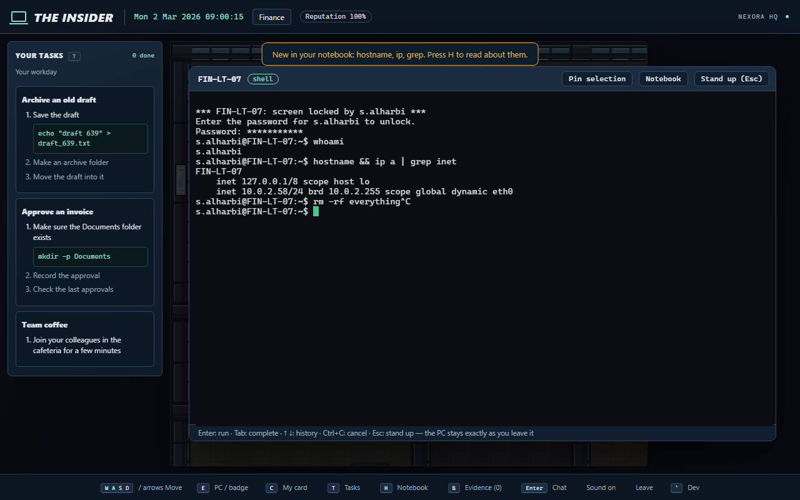

*The shell: you type a command and press Enter, and the answer appears underneath.*

The black window is a **shell**: you type a command, press `Enter`, and the PC answers. The line at the bottom of the window reminds you of the keys:

| Key | What it does |
|---|---|
| `Enter` | run the line |
| `Tab` | **complete** the command or file name you started. If several fit, they are listed under the line |
| `↑` `↓` | bring back earlier lines (handy for asking the same thing again) |
| `Ctrl+C` | throw the line away (or stop a password question) |
| `Esc` | stand up |

`Tab` only shows what you may see anyway (like `ls` would) and leaves no trace in any log.

### The commands you'll use most

You don't need to know these by heart. Type `help` for the list, or `man NAME` for one command's page (`man last`).

| Command | What it does | Example |
|---|---|---|
| `whoami` | which account you're using right now | `whoami` |
| `ls` | list the files in a folder | `ls /var/log` |
| `cat` | show a whole file | `cat /etc/passwd` |
| `tail` | show the end of a file (the newest lines) | `tail /var/log/auth.log` |
| `grep` | show only the lines that contain a word | `grep "Failed password" /var/log/auth.log` |
| `last` | who logged in to this machine, from which address, and when | `last` |
| `who` / `w` | who is logged in right now | `who` |
| `ssh` | connect to another machine (and `exit` to come back) | `ssh ADMIN-SRV-01` |
| `nslookup` | which PC has an address | `nslookup 10.0.2.15` |
| `mail` | your inbox; `mail 2` shows message 2 with its headers | `mail` |
| `ps aux` | the programs running on this PC | `ps aux` |
| `sudo` | run one command as the administrator (only if you're allowed) | `sudo cat /var/log/auth.log` |
| `siem` | search the logs of every machine at once (SOC analyst's PC only) | `siem help` |
| `helpdesk` | the helpdesk console (IT helpdesk's PC only) | `helpdesk status` |
| `loginctl lock-session` | lock this screen | |

You can combine commands with `|`: `last | grep 10.0.2.185` shows only the logins from that address.

### Your notebook

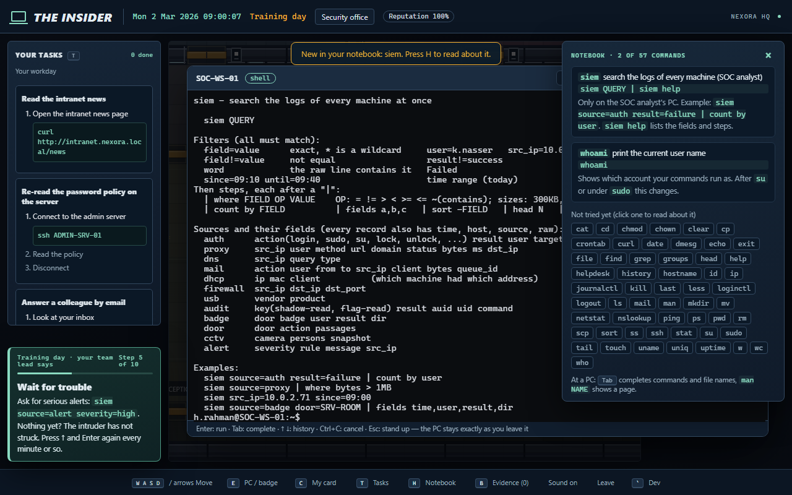

*Right: the notebook. Every command you've used, with what it does. Below it, the ones you haven't tried yet.*

The game writes down **every command you use**, with its manual page, in your **notebook**. Open it with `H` (when standing) or the **Notebook** button in the terminal's title bar.

- At the top: the commands you've used, with an example and an explanation.
- Under *Not tried yet*: all the others. Click one to read about it.
- The notebook is kept from match to match, in this browser.

### Tips

When you play a defender and seem stuck for a while, a small **Tip** appears at the bottom of the screen: how to sit down, where the logs are, which command finds a line. The tips are general (they never know who the hacker is). They come after about 75 seconds without progress on **Easy**, after about 2½ minutes on **Normal**, and **never on Hard**. **Got it** closes one. There are no tips for the hacker.

---

## 7. Playing as a defender

### Your goal

Find out which colleague is the hacker, **collect evidence**, and **convince the others** at a meeting. In solo modes the case panel (`M`) reminds you of the goal and where your job finds things.

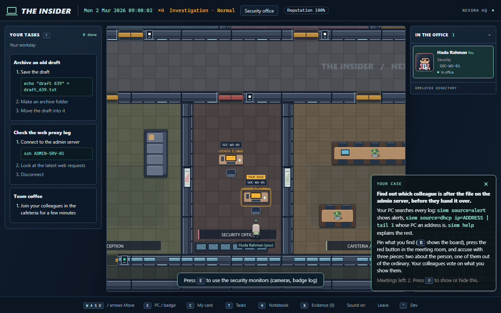

*Your case (`M`): the goal, where your job looks, and what convinces your colleagues.*

### The jobs

Your job decides which logs you may read and what else you can do.

| Job | What only this job can do | Good first moves |
|---|---|---|
| **Employee** | Nothing special: your own PC, your eyes and your vote. The hardest job | check your own PC (`last`, `ps aux`, `tail /var/log/auth.log`); on the admin server `last` and the DHCP leases are open to you |
| **SOC analyst** | The **SIEM**: search the logs of every machine from your own desk | `siem source=alert severity=high`, then follow the address |
| **Security guard** | The **monitors** in the security office (cameras, badge log, motion log), and **detaining** somebody | watch the cameras, read the badge log, follow suspicious people |
| **System administrator** | `sudo` on every machine, and all the server logs. The hacker's favourite target | lock your screen! Check `last` on the servers for logins as you from other PCs |
| **IT helpdesk** | `helpdesk status` (every PC: open, locked, logged out), `helpdesk lock HOST` (lock any PC), `helpdesk reset USER` (a new password) | look for open PCs, lock them, and see who was sitting there |

### Where the evidence is

| What happened | Where it's written down |
|---|---|
| Logins, `sudo`, locks, failed passwords | each machine's `/var/log/auth.log`; the commands `last`, `who`, `w` |
| Which PC had which address | `/var/lib/dhcp/dhcpd.leases` on `ADMIN-SRV-01`, or `siem source=dhcp` |
| Badge taps, doors | `/var/log/badge/access.log` and `doors.log` on `SEC-SRV-01`; the monitors |
| Cameras | `/var/log/cctv/motion.log` on `SEC-SRV-01`; the pictures on the monitors |
| Mail | `/var/log/mail.log` on `ADMIN-SRV-01`; your own inbox with `mail` |
| Web visits and name lookups | `/var/log/squid/access.log` and `/var/log/named/queries.log` on `ADMIN-SRV-01` |
| Security alerts | `/var/log/security/alerts.log` on `SEC-SRV-01`, or `siem source=alert` |
| USB devices plugged in | `dmesg` on the PC itself |

When something serious happens, **everybody** sees a vague red banner: *unusual activity was detected on the company network*. It doesn't say what or where. Finding that out is your job.

### Following the trail: alert → address → PC → person

This is the core skill. An example (names and addresses change every match):

1. **The alert.** A HIGH alert says something happened, and from which address: `src_ip=10.0.2.185`.
2. **The address → the PC.** The DHCP log tells you which PC had that address at that time: `ip=10.0.2.185 … client=HR-LT-03`.
3. **The PC → the person.** The office list on the right shows whose desk `HR-LT-03` is: Lina Haddad.
4. **More clues.** What else did that address do? A login to the admin server from `10.0.2.185` as `l.haddad`. Now three clues from three different places point at the same person.

As the SOC analyst it takes three searches:

```
siem source=alert severity=high
siem source=dhcp ip=10.0.2.185 | tail 1
siem source=auth host=ADMIN-SRV-01 action=login src_ip=10.0.2.185 | tail 1
```

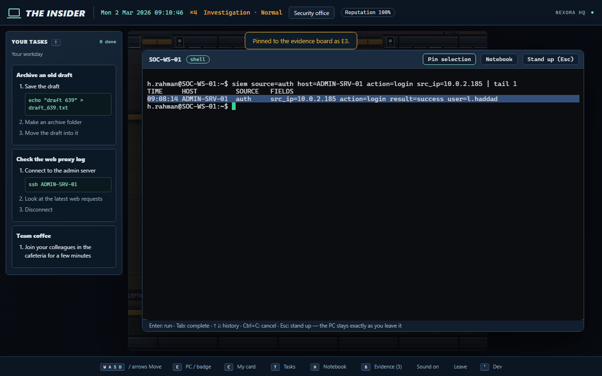

*The SOC analyst following an alert with the SIEM.*

**Careful: an address leads to a PC, not to a person.** If Lina left her PC open, somebody else may have sat there. Cameras, badge taps and witnesses tell you who was *really* at the keyboard. A good case has clues from different places.

### The security monitors

In the security office stand the **monitors**. Whoever stands in front of them and presses `E` can look at:

- **Cameras:** each camera's recording, with a slider to go back in time. **Pin this picture** puts the picture on the evidence board.
- **Badge log:** every tap at every door.
- **Motion log:** when each camera saw movement.

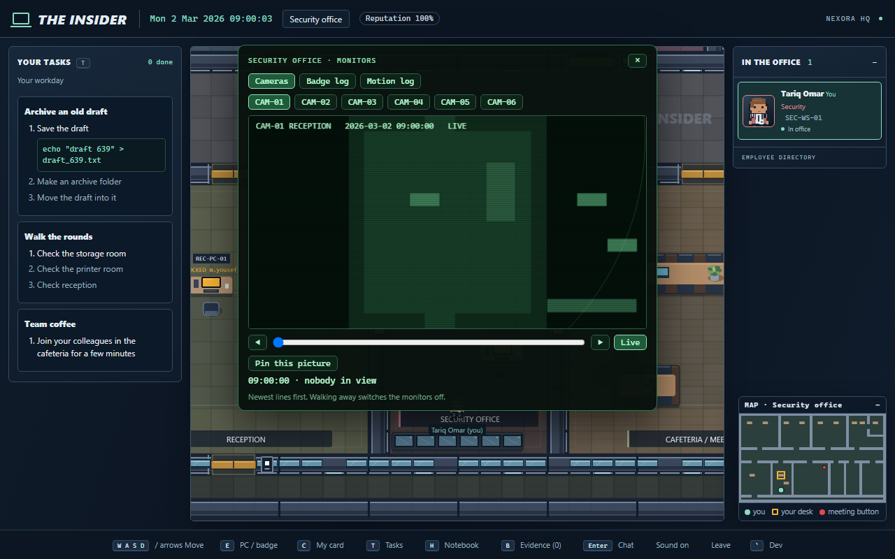

*The monitors in the security office. The security office door keeps most people out.*

### Pinning evidence

When you find a telling line:

1. **Select it** with the mouse in the terminal.
2. Press **Pin selection** at the top of the terminal window.

It goes onto the **evidence board** (`B`), which everybody can see, numbered **E1, E2, E3…**. Each piece shows who pinned it and when. Only you can take your own pins down.

You can only pin what really appeared on your own screen, so nobody can invent evidence.

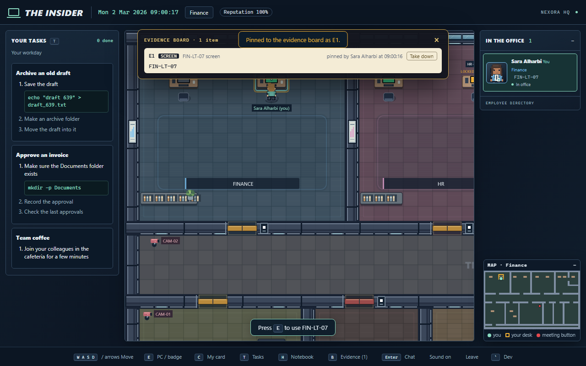

*The evidence board (`B`): shared by everybody.*

### What makes evidence convincing

To accuse somebody you need **at least three** pieces of evidence. In solo matches (and when people are few at a meeting) the bots **judge** them before they vote:

- **At least two pieces must be about the person you accuse:** their account, their name, their PC, their address, their badge, or a camera picture of them.
- **At least one must be out of the ordinary:** an alert, a failed password, a login from the wrong PC, a USB device, a door they had no business at.
- These **don't count:** old lines from before the match, lists that name everybody, and lines you typed yourself.

If the evidence doesn't convince them, the bots vote *skip* and say why in the chat.

### Detaining (security guard only)

The guard can catch the hacker in the act. Stand right next to the person and press `X`, then `X` again within 3 seconds to confirm.

- **Right person:** the defenders win at once (with several hackers, that one is out).
- **Wrong person:** they are let go, everybody is told, and **you lose this power for the rest of the match.**

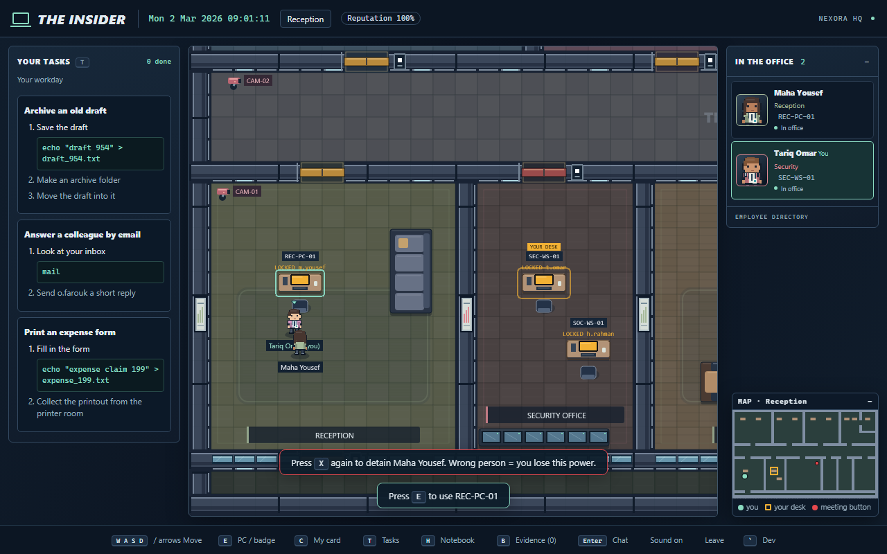

*Detaining: one chance, so be sure.*

---

## 8. Meetings and voting

### Calling a meeting

The red **emergency button** is in the meeting room (the cafeteria). Stand at it and press `E`. Everybody is brought to the table; anybody sitting at a PC is stood up, and the PCs stay exactly as they were.

- In solo matches you can call **two** meetings; with friends and in the shared office, **one**.
- After a meeting the button rests for a minute.
- The case panel (`M`) shows how many meetings you have left.

### What happens at a meeting

A meeting has four parts. A red **Emergency meeting** sign and a bell open it.

**1. Discussion** (1½ minutes). Everybody talks in the meeting chat. Bots say what they noticed themselves (*"I saw somebody at my PC"*). To accuse, press **Accuse someone**, choose the person, tick at least three pieces of evidence and present them. Without an accusation there's no vote.

The accusation and its evidence go up **on the screen** for everybody to read:

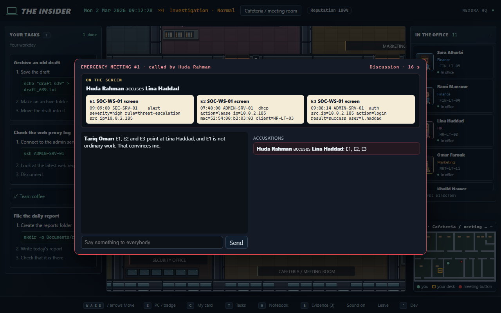

*On the screen: who accuses whom, and the three pieces of evidence. In the chat a colleague says the evidence convinces them.*

**2. Defence** (10 seconds per accused person). Each accused person **has the floor** and can answer in the chat: where were they, what did they do? Nobody can vote meanwhile.

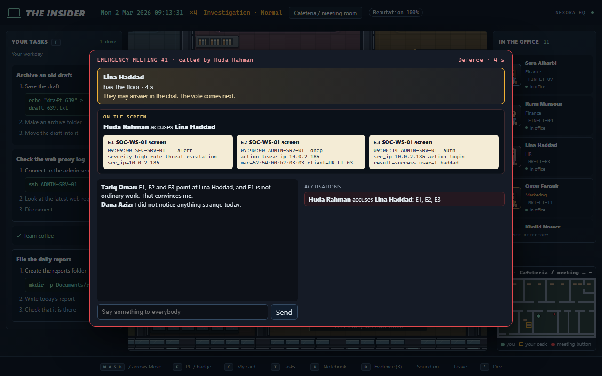

*The defence: the accused may explain themselves before the vote.*

**3. Voting** (45 seconds). Everybody who was there when the meeting was called votes once: for an accused person, or **skip**. You can see who has voted, but not for whom.

**4. The result.** The ballots are turned over one by one, then the verdict:

- the person with **the most votes** is voted out, if they got **more votes than skip**;
- a **tie** means nobody is voted out;
- with friends, it takes **at least two votes** to vote somebody out.

A stamp shows the verdict: **Hacker caught** or **Wrong person** (or the line *Nobody was voted out*).

### Right or wrong

| Who was voted out | What happens |
|---|---|
| **The hacker** | Hacker caught: the defenders win (with several hackers, that one is out and the match goes on) |
| **An innocent colleague** | They are **fired** and out of the game. The company's **reputation drops by 25 %**. The match goes on |

At **0 % reputation** (the fourth wrong firing) the company is ruined and the hacker wins. So don't guess.

### When you are out

A fired player **watches**: you can look around the whole office freely (arrow keys or dragging move the view, the mouse wheel zooms, `N` or a click on a person follows them), read every room's chat and the meetings, and talk with other fired players. You can't talk to the living, use a PC or vote. You don't learn the secrets until the match is over.

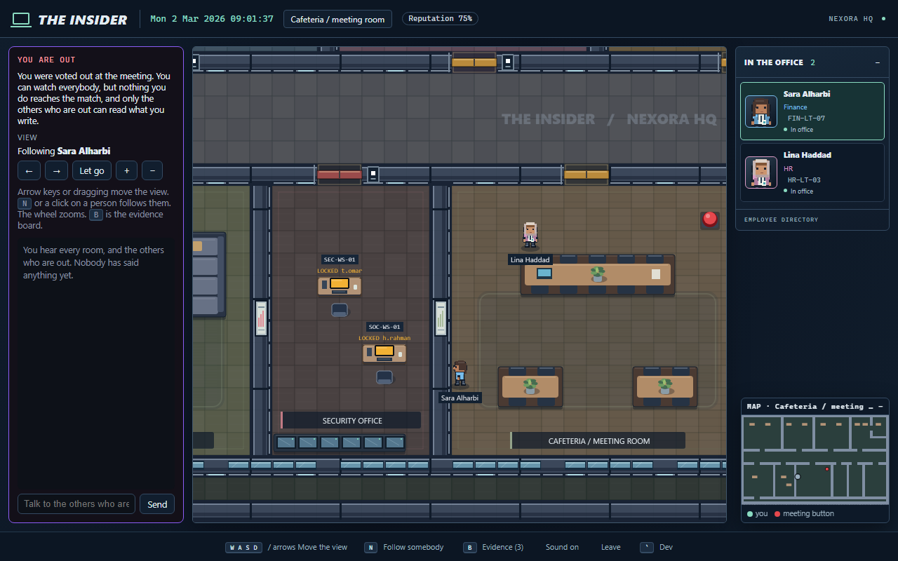

*Watching after being fired.*

---

## 9. Playing as the hacker

You're an ordinary employee with a normal job and desk, and a secret.

### Your goal

The file is `/root/flag.txt` on `ADMIN-SRV-01`. Only the administrator (root) can read it. Read it, copy its text, and **hand it in** in your private briefing.

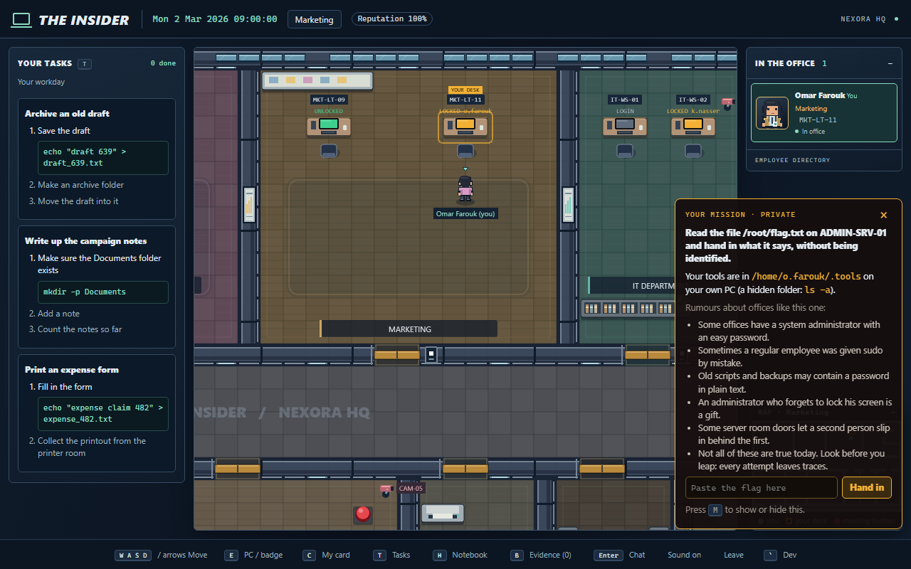

*Your private briefing (`M`). Only you see it.*

### Your briefing (`M`)

- **The goal**, and where your tools are: a hidden folder `~/.tools` on your own PC (`ls -a` shows hidden folders). Its `README` lists everything.
- **Rumours** about the office: things that *might* be weak today. You aren't told which ones are true. Finding out is part of the game, and every try leaves traces.
- **The hand-in box:** paste the flag's text and press **Hand in**. It only counts if you really read the file yourself in this match.
- **The waiting time:** after you first read the flag your contact needs a few game minutes before you can hand it in (solo: 2, 4 or 5 minutes on Easy, Normal or Hard; with friends: 5, 3 or 2 minutes, by the lobby's difficulty). Reading the flag raises a HIGH alert, so this wait is the defenders' last chance.

### Your tools

All of them are pretend game items, and **every one leaves a trace**. The game's rule: *there is no perfect crime, only well-hidden ones.*

| Tool | What it does in the game | What gives it away |
|---|---|---|
| `~/.tools/selftest` | checks that the toolkit works | nothing (harmless) |
| `~/.tools/phish USER` | sends one colleague a fake "IT password reset" message | the mail's headers show the PC it really came from |
| `~/.tools/scan` | lists the machines and their services | raises an alert at once |
| `~/.tools/crack FILE` | works out passwords from a stolen password file | reading the password file is logged and alerted |
| `~/.tools/keylogger` | records the next password typed at this PC | a strange program in `ps aux`, a file left behind |
| `~/.tools/implant HOST` | works through a PC where the USB stick was used | an open connection in `ss`, an odd program |
| `~/.tools/clean LOG "TEXT"` | removes lines from a log | leaves a *log cleared* marker and a gap in time |
| **USB stick** (hold `U` 5 s at an *unlocked* PC, standing) | sets up a backdoor on that PC | the PC logs the USB device; people nearby and cameras see you crouching |
| **Your eyes** (stand right behind somebody typing a password) | you catch a few of its letters | bot colleagues remember who stood behind them |

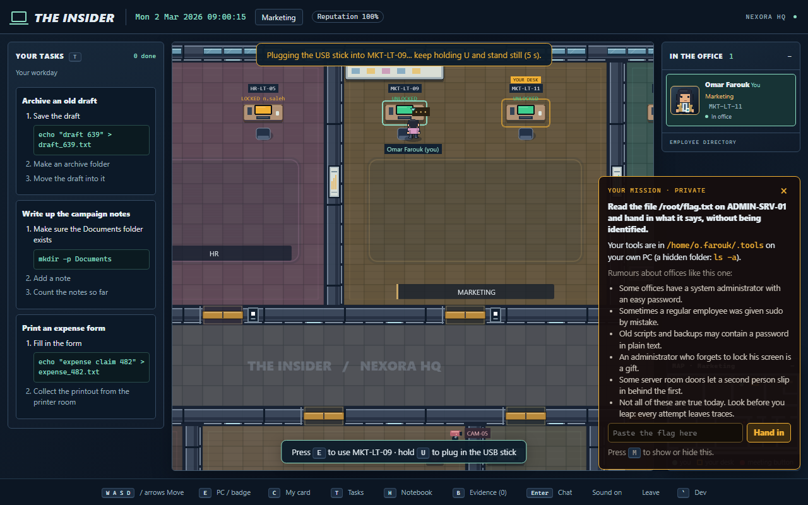

*The USB stick: five seconds crouched at somebody's PC, in plain view.*

### Every match is different

Each match switches on a few **weaknesses** (two to four), chosen at random: for example an old script with a password in it, an administrator with a simple password, an employee given `sudo` by mistake, an administrator who forgets to lock, a server-room door that stays open a moment too long. So you can't learn one route by heart.

### Staying hidden

- Do your **job tasks**: they make you look like everybody else and fill the logs with ordinary lines.
- Remember that **an address points to a PC**: whatever you do from your own desk points at your own desk.
- Watch for colleagues, cameras and the guard.
- Every 10 to 20 game minutes the security system raises one of your oldest traces again as a new alert. The longer you wait, the more of your trail shows up.

### Winning and losing

- **You win** when the flag is handed in. With friends you also win if the defenders run out of people (as many hackers as defenders left) or the company's reputation reaches 0 %.
- **You lose** when you're voted out or detained.

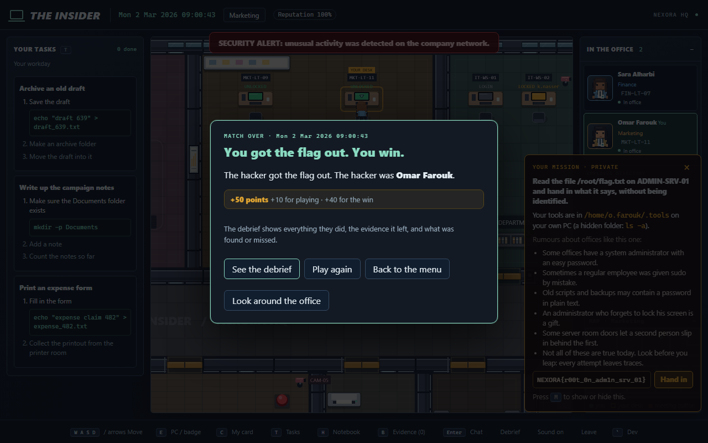

*"You got the flag out. You win."*

### More than one hacker

With friends, a match can have up to three hackers. You know each other from the start, see each other in red, and have a **private chat**. Any of you can hand in a flag that one of you read.

---

## 10. Every mode in detail

### Training day: your first case, with a guide

You're the new **SOC analyst**. A team lead in the bottom-left corner tells you what to do, one step at a time, and moves on by itself when you've done it:

1. **Your card:** read it, press `C` to put it away.
2. **Your desk:** walk to `SOC-WS-01` in the security office and press `E`.
3. **Log in:** type the password from your card.
4. **The SIEM:** type `siem help`.
5. **Wait for trouble:** `siem source=alert severity=high`, again every minute or so, until an alert appears.
6. **Pin the alert:** select the line, press **Pin selection**.
7. **Which PC?** `siem source=dhcp ip=ADDRESS | tail 1`, and pin it.
8. **Which login?** `siem source=auth host=ADMIN-SRV-01 action=login src_ip=ADDRESS | tail 1`, and pin it.
9. **Call a meeting** at the emergency button.
10. **Make your case:** accuse the owner of that PC with your three clues.

It takes about twenty minutes, and the intruder is slow today. After a win the menu marks the training as **done** and the defender ladder is next.

### Investigation: one case, a job of your choice

You're a defender; one of your colleagues (a bot) is the hacker. Choose:

- **Your job:** Employee, SOC analyst, Security guard, System administrator, IT helpdesk, or *Surprise me*.
- **Difficulty:**

| | Easy | Normal | Hard |
|---|---|---|---|
| Ways into the office today | 2 | 3 | 4 |
| Colleagues who forget to lock their PC | few (15 %) | some (25 %) | many (40 %) |
| What the hacker knows | only rumours, and takes its time | some of the weaknesses | all of them, and is fast |
| Help from colleagues | they pin up to three clues | they only speak at meetings | they only speak at meetings |
| Tips | after about 75 s | after about 2½ min | none |

**You win** when the hacker is voted out or detained. **You lose** when the flag is handed in, or too many innocent people are fired.

### Infiltration: you are the hacker

Every colleague is a bot, and they **defend**: they check their own PCs now and then, the SOC analyst follows alerts, the guard watches the cameras, and they call meetings and vote on what they pin.

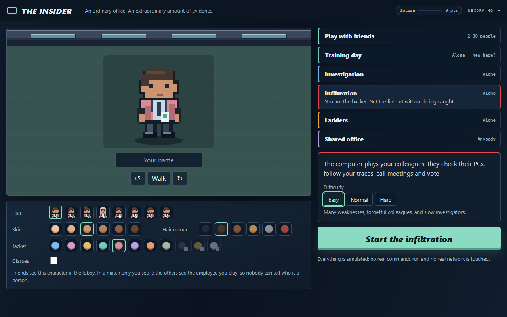

| | Easy | Normal | Hard |
|---|---|---|---|
| Weaknesses | 4 | 3 | 2 |
| Colleagues who forget to lock | many | some | few |
| Investigators | slow | take their time | come quickly |
| Wait before handing in | 2 game min | 4 game min | 5 game min |

**You win** only by handing in the flag. **You lose** if you're voted out or detained.

### Ladders: fixed cases that get harder

Each ladder has five levels. They're the same every time you play them, each teaches one thing, and winning one opens the next. Choose the ladder at the top of the tab.

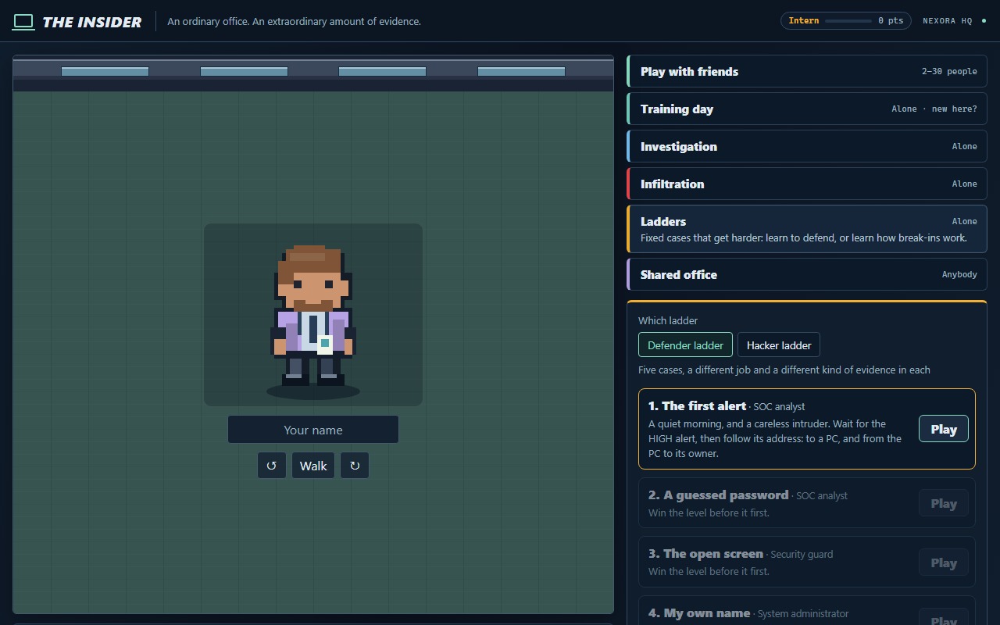

*The defender ladder: each case names the job you'll play.*

**Defender ladder** (you defend; the job is fixed per case):

| # | Case | Your job | What it teaches |
|---|---|---|---|
| 1 | The first alert | SOC analyst | follow an alert's address to a PC, and the PC to its owner |
| 2 | A guessed password | SOC analyst | many failed passwords, then one success, from one address |
| 3 | The open screen | Security guard | an open PC lends its owner's name; cameras and badges show who sat there |
| 4 | My own name | System administrator | a login *as you* from a PC that isn't yours means a stolen password |
| 5 | Everything at once | SOC analyst | real cases mix false trails with true ones; don't accuse too early |

**Hacker ladder** (you're the hacker):

| # | Level | What it's about |
|---|---|---|
| 1 | Old habits | a password left in an old script |
| 2 | The company password | a password that's easy to guess, and why your own address gives you away |
| 3 | The borrowed chair | using a colleague's open PC, and why people lock their screens |
| 4 | Eyes everywhere | cameras in the departments; going through another machine |
| 5 | Locked down | everybody is careful; everything you've learned, together |

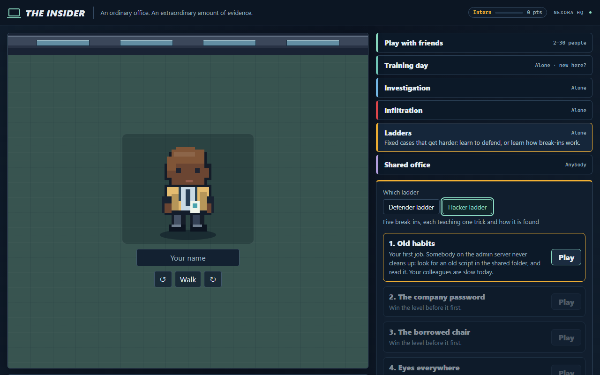

*The hacker ladder. Closed levels open when you win the one before.*

After each level a short **lesson** explains what it was about, and the button **Next** takes you straight to the next one.

### Play with friends

**Creating a lobby:**

1. Type your name under your character.
2. Choose **Play with friends** and press **Create a lobby**.
3. Send your friends the **link** (or the five-letter **code**).

**Joining:** open the link (or type the code under *Code from a friend*), type a name, press **Join the lobby**, then **I am ready**.

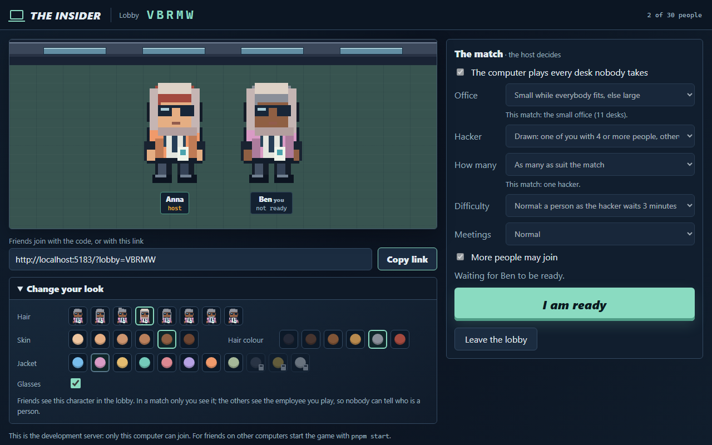

*The lobby, as a friend who joined sees it: everybody's character, the link to invite more, the host's settings, and **I am ready**.*

**The host chooses:**

| Setting | Choices |
|---|---|
| The computer plays every desk nobody takes | on or off |
| Office (with more than 11 people) | small (11 desks), large (30 desks), or automatic |
| Hacker | drawn (one of you if you're 4 or more, otherwise anybody), always one of you, or always the computer |
| How many | as many as suit the match, or 1, 2 or 3 hackers |
| Difficulty | how hard it is to *defend*: how many ways in, how many open screens, how good a computer hacker is, and how long a person must wait before handing in (5, 3 or 2 minutes) |
| Meetings | short (45 s to talk, 30 to vote), normal, or long (2½ min to talk, 1 to vote) |
| More people may join | on or off |

When everybody is ready, the host presses **Start the match**. Each player then sees, privately, who they are:

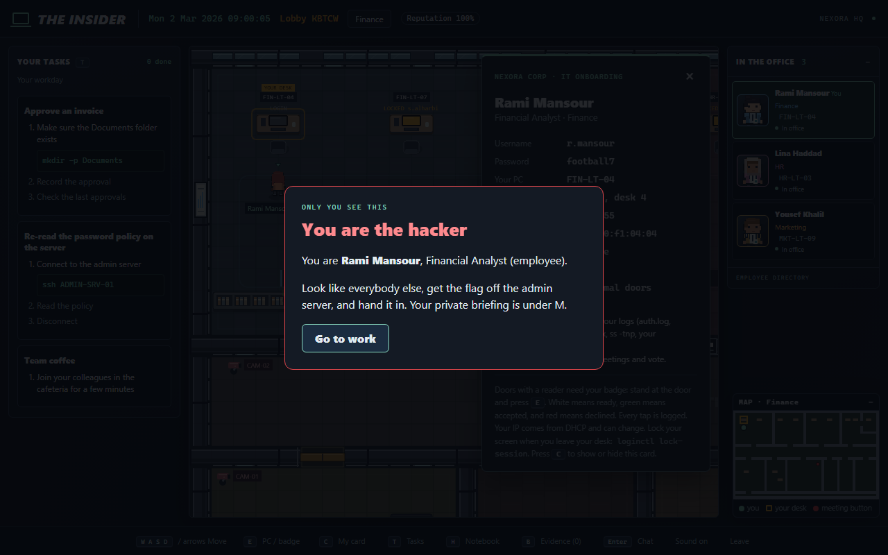

*"Only you see this": your secret role. Everybody else gets the same card saying "You are not a hacker", with the number of hackers to find.*

**Good to know:**

- If your connection drops, your place is kept for a minute. After that a bot plays your character until you come back, from the same spot.
- After a match, **Back to the lobby** takes everybody back for the next one.
- **The large office** (30 desks) has a small blue button in each department: `E` there starts a short **department meeting** with everybody nearby (one minute, no vote). The whole company can meet at most three times.

### Shared office

One office for everybody who opens it. Choose any employee on the start screen and start working beside whoever is there; the computer plays the other desks. Tick **Join as the hacker** to be the hacker (one per match, if the role is free). Everybody gets one meeting.

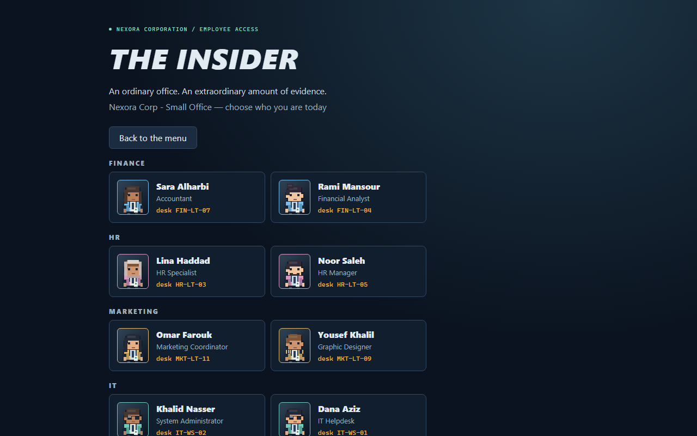

*The shared office: choose who you are today.*

---

## 11. After the match

### The end

When the match ends, a box says who won, **who the hacker was**, how well it went, and the **points** you earned.

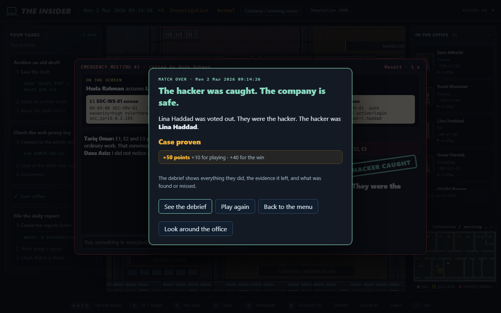

*The match is over: the rating and the points.*

The **rating** says how well it was done:

| You were | Ratings, best first |
|---|---|
| a defender who won | **Case proven** · **Case proven, at a price** (somebody innocent was fired or detained on the way) · **Lucky guess** (right person, weak evidence) |
| a defender who lost | **So close** (you had the evidence) · **The hacker got away** |
| the hacker who won | **Like a ghost** (no evidence pointed at you) · **Clean getaway** · **By a hair** |
| the hacker who lost | **Detained** · **Voted out** |

### The debrief: where you learn the most

The buttons under it:

- **See the debrief:** what really happened (below).
- **Next: …** after a won ladder level or the training day: straight to the next one.
- **Play again:** a new match of the same kind (with friends: **Back to the lobby**).
- **Back to the menu:** the home screen.
- **Look around the office:** close the box and stay in the office a little longer.

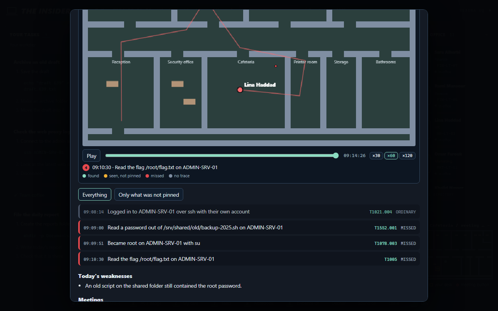

*The debrief: the replay of the hacker's path, and every step with what it left behind.*

- **The replay:** a map of the office with the hacker's path. **Play** runs it (×30, ×60 or ×120 the speed), the slider moves through the match, and numbered marks show each step:
  - **green:** found (pinned on the board),
  - **amber:** seen on somebody's screen but not pinned,
  - **red:** missed,
  - **grey:** left no trace.
- **Every step** of the hacker, with the time, what was done, the real-world name of the technique (a **MITRE ATT&CK** number), how to spot it, the log lines it wrote, and whether it was found. **Show on the map** jumps to where it happened. **Only what was not pinned** shows just what you missed.
- **Today's weaknesses:** the ways in that were open this match.
- **The meetings:** who called them, who was accused, who was voted out.

Passwords in the debrief are shown as stars.

---

## 12. Points, ranks and jackets

Every match earns points:

| For | Points |
|---|---|
| playing a match | +10 |
| winning it | +40 |
| each of the hacker's steps on the board (as a defender) | +10 |
| getting away *like a ghost* / *clean* (as the hacker) | +40 / +20 |
| winning a ladder level or the training day for the first time | +30 |

Points add up to a **rank**, shown at the top of the home screen:

| Rank | From | Unlocks |
|---|---|---|
| Intern | 0 | |
| Junior analyst | 100 | the **charcoal** jacket |
| Analyst | 300 | the **gold** jacket |
| Senior analyst | 700 | the **white** jacket |
| Incident lead | 1500 | |

Your points, ranks, ladder progress, notebook and look are saved **in this browser** (another browser or computer starts fresh).

---

## 13. All the keys

| Key | Where | What it does |
|---|---|---|
| `W` `A` `S` `D` / arrows | office | walk |
| `E` | at a desk, door, button or the monitors | sit at the PC / tap your badge / call a meeting / look at the monitors |
| `C` | office | your card |
| `T` | office | your job tasks |
| `B` | office | the evidence board |
| `H` | office | your notebook |
| `M` | office | your case (defenders) or your private briefing (the hacker) |
| `Enter` | office (shared office and friends) | chat with the people in the room |
| `X`, then `X` | next to somebody | security guard: detain |
| `U` (hold 5 s) | standing at an unlocked PC | the hacker: the USB stick |
| `Enter` | terminal | run the line |
| `Tab` | terminal | complete a command or file name |
| `↑` `↓` | terminal | earlier lines |
| `Ctrl+C` | terminal | cancel the line or the password question |
| `F2` | lock screen | switch user |
| `Esc` | terminal | stand up (the PC stays as it is) |
| `Esc` | office | close the card, the board, the monitors and the notebook |

---

## 14. Words you will meet

| Word | Meaning |
|---|---|
| **Account / username** | the name you log in with, like `s.alharbi` |
| **Address (IP address)** | a PC's number on the network, like `10.0.2.58`. It can change from day to day |
| **MAC address** | a PC's fixed hardware address, like `52:54:00:f1:07:07` |
| **DHCP** | the service that hands out addresses. Its log says which PC had which address, and when |
| **Log** | a file in which a machine writes down what happened, one line per event, with the time |
| **Shell / terminal** | the black window where you type commands |
| **Server** | a machine that serves the others: `ADMIN-SRV-01` (mail, web, DHCP, the flag) and `SEC-SRV-01` (badges, cameras, alerts) |
| **root / administrator** | the all-powerful account of a machine |
| **sudo** | "do this one command as root", for those allowed to |
| **ssh** | logging in to another machine from your own. The other machine writes down your address |
| **SIEM** | a search over the logs of every machine at once (the SOC analyst's tool) |
| **SOC** | Security Operations Centre: the team that watches for attacks |
| **Alert** | a line the security system writes when something looks wrong (LOW, MEDIUM, HIGH) |
| **Flag** | the secret file the hacker wants (`/root/flag.txt`) |
| **Pin** | put a piece of evidence on the shared board |
| **Weakness** | a way into the admin server that's open in this match |
| **Bot** | a colleague played by the computer |
| **Reputation** | the company's good name: −25 % for every innocent person fired |
| **MITRE ATT&CK** | a public catalogue of attack techniques, used by real defenders. The debrief gives each step's number |

---

## 15. Questions and problems

**How long is a match?**
There's no time limit. A match ends when somebody wins. Solo matches often take 15 to 30 minutes; the training day about twenty.

**I don't know where to start as a defender.**
Sit at your PC and log in. Then look at your own logs (`last`, `tail /var/log/auth.log`), or play the training day first. Tips appear by themselves on Easy and Normal.

**I can't read a file: "Permission denied".**
Your job doesn't allow it. Each job reads different logs (see [the jobs](#the-jobs)). Somebody else may have to look, or you find the same fact somewhere else.

**The page says my password is wrong.**
Check the card (`C`): the username and password are both there. If the helpdesk reset your password, your card shows the new one.

**Somebody used my PC!**
You probably left it open. Lock it next time: `loginctl lock-session`. The logs will show *your* name for what they did, so tell the next meeting.

**Is the computer cheating?**
No. Bots see only what they could really see: their own screen, the room they're in, what's said at meetings. The hacker bot uses the same tools and leaves the same traces as a person.

**My notebook or rank is gone.**
They're kept in the browser. Another browser, another computer or a private window starts fresh.

**I closed the page during a match.**
Open the game again: a line at the top offers to take you back. With friends your place is kept for a minute, then a bot stands in until you return.

**Friends can't connect.**
See [docs/play-with-friends.md](docs/play-with-friends.md), section *When it does not work*.

---

Have fun, lock your screen, and trust the evidence, not the alibi.
