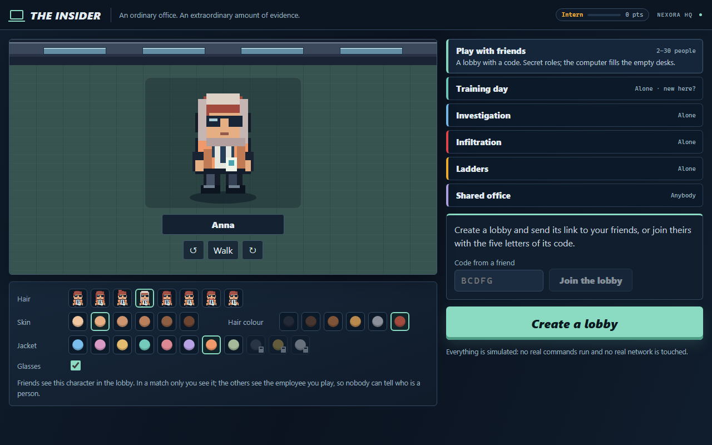
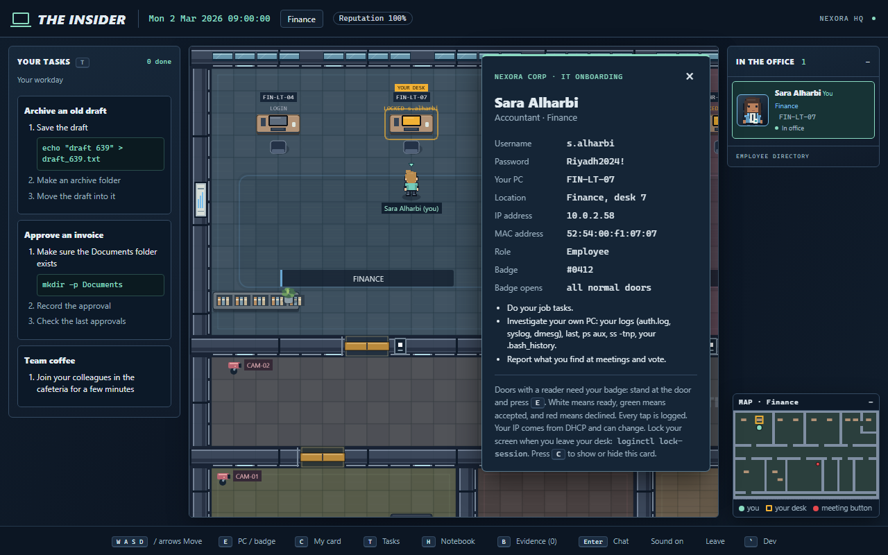
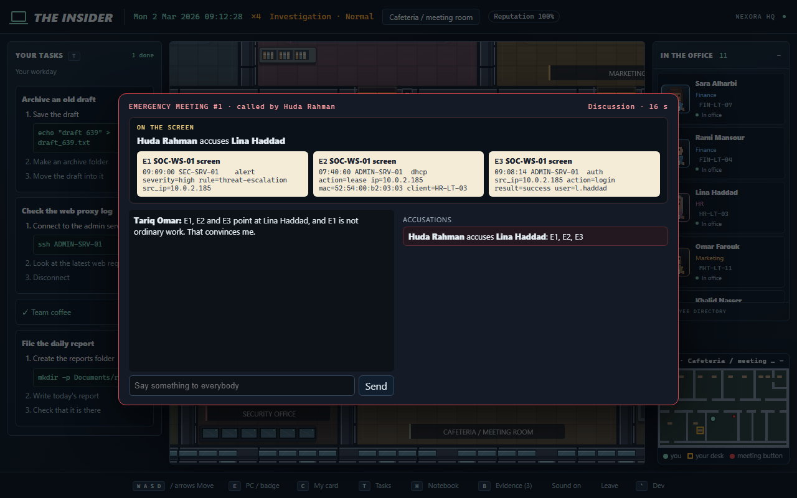
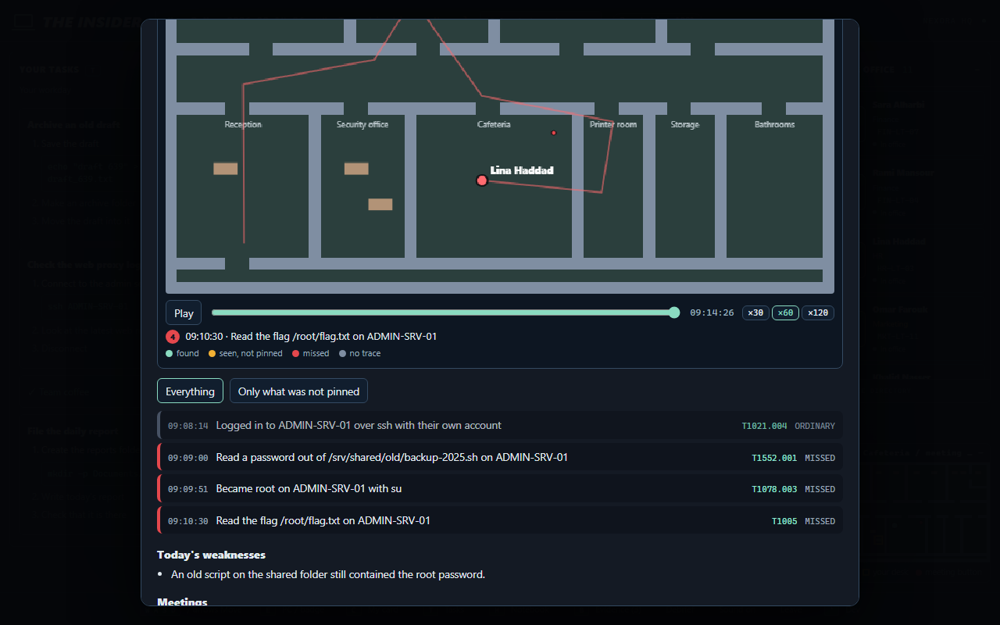
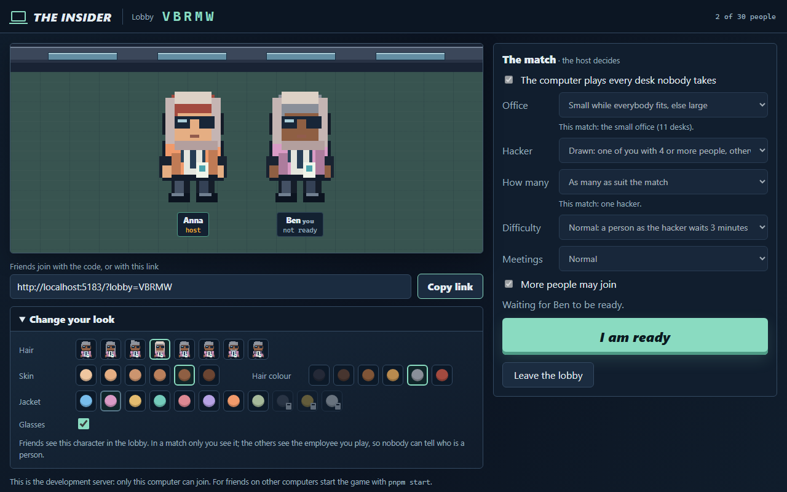
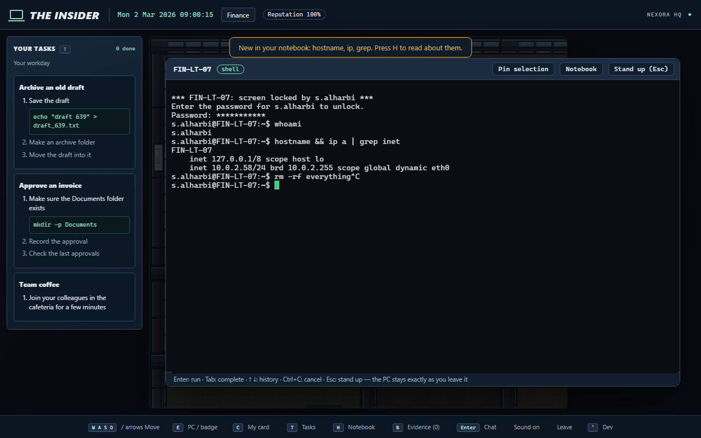
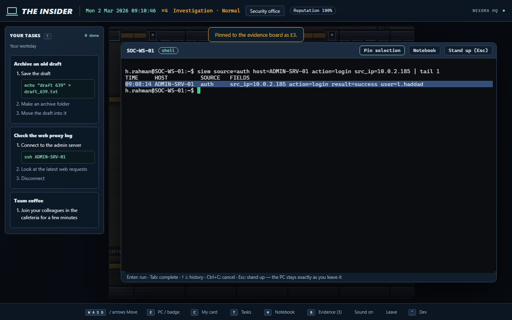
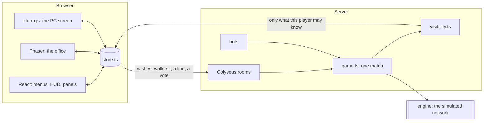

<div align="center">

# The Insider

**An ordinary office. An extraordinary amount of evidence.**

A multiplayer social-deduction game that teaches real Linux forensics.
One of your colleagues is stealing a file from the admin server. Find out who, with evidence, before they hand it over.




</div>

---

## Contents

- [What it is](#what-it-is)
- [Features](#features)
- [Screenshots](#screenshots)
- [Quick start](#quick-start)
- [How to play](#how-to-play)
- [Game modes](#game-modes)
- [Architecture](#architecture)
- [Configuration](#configuration)
- [The command-line client](#the-command-line-client)
- [Testing](#testing)
- [Project layout](#project-layout)
- [Simulation notes](#simulation-notes)
- [Extending the game](#extending-the-game)
- [Safety](#safety)
- [Roadmap](#roadmap)
- [Documentation](#documentation)

## What it is

The Insider is played in a small company, Nexora, drawn as a top-down pixel office. Everybody has a desk, a badge and a PC with a Linux shell. One of the employees (a person or the computer) is a hacker who wants a file from the admin server.

- **Defenders** read logs, follow IP addresses to PCs and PCs to people, look at cameras and badge logs, pin evidence to a shared board, and convince the others at a meeting.
- **The hacker** looks like everybody else, uses simulated tools, borrows open screens, and has to get the file out before the evidence piles up.

Everything a player does leaves real-looking traces: `auth.log`, `last`, DHCP leases, proxy and DNS logs, badge taps, camera pictures. The forensics are real; the attacks are not.

> **Everything is simulated.** The game runs a pretend office network inside its own engine. No real command is run, no real network is touched, and nothing here is a real exploit.

## Features

**Ways to play**
- **Play with friends:** a lobby with a five-letter code for 2 to 30 people, secret roles, up to three hackers, and the computer filling empty desks.
- **Training day:** a guided first case as the SOC analyst, step by step.
- **Investigation** and **Infiltration:** solo matches against bots, as a defender or as the hacker, in three difficulties.
- **Ladders:** five fixed cases for defenders and five fixed break-ins for hackers, each teaching one kind of evidence.
- **Shared office:** walk in and work beside whoever is there.

**Learning built in**
- **Tab completion** of commands and file names (only what `ls` would show you).
- **A notebook** (`H`) of every command you have used, with its manual page.
- **Gentle hints** for defenders who seem stuck (often on Easy, never on Hard).
- **The debrief:** every step of the hacker, the evidence it left, what was found or missed, the MITRE ATT&CK technique, and a **replay on the map**.

**A living office**
- Bot employees work, write mail, browse, take breaks, check their PCs, notice things and vote. On screen nobody can tell bots from people.
- Badge doors, cameras, a security office with monitors, a SIEM for the SOC analyst, a helpdesk console, a guard who can detain.

**Meetings as a show**
- The evidence against the accused goes up on a shared screen, each accused person gets the floor to answer, and the ballots are turned over one by one.

**Your own character**
- A home lobby with a character you dress (hair, skin, jacket, glasses), ranks and points for every match, and jackets that come with a rank.

## Screenshots

| The office | A meeting | The debrief |
|---|---|---|
|  |  |  |

| The lobby with friends | At a PC | The SOC analyst's trail |
|---|---|---|
|  |  |  |

## Quick start

**Requirements:** Node.js 20 or newer (developed on Node 24) and pnpm (the repository pins `pnpm@12.21.0`).

If `pnpm` is not found, run `corepack enable`, or put `corepack` in front of every command (`corepack pnpm install`). Corepack ships with Node.

```bash
pnpm install
```

**Play on this computer:**

```bash
pnpm dev
```

Open http://localhost:5173. New here? Choose **Training day**, and read [HOW_TO_PLAY.md](HOW_TO_PLAY.md).

**Play with friends at home:**

```bash
pnpm start
```

This builds the page and serves the game on one address that other computers in the same home network can open. Step by step: [docs/play-with-friends.md](docs/play-with-friends.md).

## How to play

**The full guide, with pictures of every screen and mode: [HOW_TO_PLAY.md](HOW_TO_PLAY.md).** The short version:

1. On the home screen, type your name under your character, dress it if you like, choose a way to play and press the big button.
2. Your **card** (`C`) has your username, password, PC and badge. Walk to your desk and press `E` to sit down.
3. Log in and investigate. Select a telling line with the mouse and press **Pin selection**: the board (`B`) keeps it.
4. When three clues point at one person, press the emergency button in the meeting room, accuse with your evidence, and vote.

| Key | Where | What it does |
|---|---|---|
| `W A S D` / arrows | office | walk |
| `E` | at a desk / door / button | use the PC / tap your badge / call a meeting |
| `C` | office | your onboarding card |
| `T` | office | your job tasks |
| `B` | office | the shared evidence board |
| `H` | office | your notebook of commands |
| `M` | office | your case (defenders) or your private briefing (the hacker) |
| `X` | next to somebody | security guard only: detain (press twice) |
| `U` (hold) | at a desk | hacker only: plug in the USB stick (5 s) |
| `Enter` | office | chat (only the people in the same room hear you) |
| `Tab` | terminal | complete a command or file name |
| `↑` `↓` | terminal | earlier lines |
| `Ctrl+C` | terminal | cancel the line or the password question |
| `F2` | lock screen | switch user |
| `Esc` | terminal | stand up (the PC stays exactly as you left it) |

On the map a monitor is green when unlocked, amber when locked (with the user's name) and grey at the login prompt. Your own desk glows, and the minimap in the corner shows where you are. Doors with a small box have a badge reader; dark red doors open only for certain badges, and every tap is written to `/var/log/badge/access.log` on `SEC-SRV-01`.

**Where the evidence is:**

| What | Where |
|---|---|
| Logins, sudo, locks, cron, clock sync | each machine's `auth.log` and `syslog`; `last`, `who`, `w` |
| Which PC had an address | `ADMIN-SRV-01:/var/lib/dhcp/dhcpd.leases`, or `siem source=dhcp` |
| Badge taps; doors and how many passed | `SEC-SRV-01:/var/log/badge/access.log`, `doors.log` |
| Camera motion | `SEC-SRV-01:/var/log/cctv/motion.log`; the pictures on the security monitors |
| Mail traffic and mailboxes | `ADMIN-SRV-01:/var/log/mail.log`, `/var/mail/USER` |
| Web requests and name lookups | `ADMIN-SRV-01:/var/log/squid/access.log`, `/var/log/named/queries.log` |
| Security alerts | `SEC-SRV-01:/var/log/security/alerts.log`, or `siem source=alert` |

**The hacker's toolkit** (simulated) is in `~/.tools` on their own PC, with a README. Two examples:

| Game command | What it does |
|---|---|
| `~/.tools/phish USER` | Sends one simulated "IT reset" message. Headers (`mail NUMBER`) show where it really came from. Cooldown 60 game seconds. |
| `~/.tools/clean LOG "TEXT"` | Removes lines from a writable log under `/var/log`, leaving a visible tampering marker. Cooldown 30 game seconds. |

## Game modes

| Mode | Players | You are | You win when |
|---|---|---|---|
| Play with friends | 2–30 people + bots | a secret role | defenders: every hacker is voted out or detained; hackers: the flag is handed in, or the defenders lose the majority |
| Training day | 1 + bots | the SOC analyst, with a guide | the intruder is voted out |
| Investigation | 1 + bots | a defender (any job) | the bot hacker is voted out or detained |
| Infiltration | 1 + bots | the hacker | the flag is handed in without being caught |
| Defender ladder | 1 + bots | a fixed job per case | the case is solved; the next one opens |
| Hacker ladder | 1 + bots | the hacker | the break-in works; the next one opens |
| Shared office | anybody | the employee you choose | as in Investigation |

The difficulty decides how many ways into the office there are today, how often colleagues leave screens open, and what the computer hacker knows. In lobbies the host chooses it, along with the number of hackers, meeting lengths and the office size (11 or 30 desks).

## Architecture



| Package | What it is |
|---|---|
| `packages/engine` | The simulation: machines, users, files, logs, a shell with pipes and redirection, mail, web, DHCP, DNS, badges and cameras. Pure TypeScript, deterministic, no I/O. |
| `packages/server` | The game server (Colyseus): matches, bodies, doors, bots, meetings, evidence, the debrief, lobbies. |
| `packages/client` | The browser game: React, Phaser and xterm.js around one store. |
| `packages/shared` | Message types, the map format, movement rules, lobby and look rules used by both sides. |
| `packages/cli` | A text client for the engine without graphics. |

Principles the code keeps to:

- **The server decides everything.** The browser only sends what the player wants ("walk left", "sit here", "this line"); the server checks it and answers.
- **The visibility rule.** The server knows every password and who really did what. A browser receives only the public physical state, its own card, and the text on the screen it sits at. Every outgoing message is built field by field in `visibility.ts`, and tests record every byte to prove that nothing secret leaks. The debrief is sent only after the match.
- **Bots are ordinary bodies.** A bot walks, taps badges, sits and types through the same functions as a person, so it leaves the same logs and looks the same on every screen.
- **Deterministic.** The engine never reads the real clock or `Math.random()`. Same seed and same inputs give the same world, and the whole world is plain JSON (a save file).
- **Events first, logs second.** Every action is recorded in a master event list (the truth, never shown) and then written as the realistic log lines a defender would find.

```ts
import { createWorld, openTerminal, sendInput, advanceTime, serializeWorld } from '@insider/engine';

const world = createWorld(scenario, 1);                 // scenario = parsed JSON, 1 = seed
const t = openTerminal(world, 'FIN-LT-07', 'p1');       // player p1 sits at a PC
const r = sendInput(world, t.terminalId, 'whoami');     // type one line: { output, prompt, events, awaitingInput? }
advanceTime(world, 5 * 60_000);                         // five minutes of game time
const save = serializeWorld(world);                     // the complete state as JSON
```

## Configuration

| Command | What it does |
|---|---|
| `pnpm dev` | server (port 2567) and page (port 5173), this computer only, with the developer panel (`` ` ``) |
| `pnpm start` | the game for friends at home: page and server on one address, no developer panel |
| `pnpm server` / `pnpm client` | only the server / only the page |
| `pnpm build` | production build of the page (`packages/client/dist`) |
| `pnpm load` | load test: 30 pretend players for a minute (`pnpm load 55 120`: 55 for two minutes) |
| `pnpm map` / `pnpm scenario` | regenerate the office maps / the 30-person scenario |

Server settings are environment variables (PowerShell: `$env:NAME='value'; pnpm dev`):

| Variable | Default | Meaning |
|---|---|---|
| `GAME_PORT` | `2567` | the server's port |
| `GAME_HOST` | this computer (dev), all (start) | the network address to listen on |
| `SCENARIO` / `MAP` | `nexora-small` / `office-small` | the shared office's company and map |
| `SEED` | new for every match | fixed random numbers (the shared office uses 1) |
| `SOLO_LIMIT` / `LOBBY_LIMIT` | `20` / `20` | solo matches / lobbies at the same time |
| `TIME_SPEED` | `1` | game seconds per real second |
| `BOTS` | on | `0` = an empty office |
| `BOT_HACKER` | on | `0` = bots without a computer hacker |
| `BOT_HACKER_DIFFICULTY` | `normal` | what the computer hacker knows: `easy`, `normal`, `hard` |
| `BOT_HACKER_PACE` | `normal` | `fast` = no pauses, for demonstrations |
| `MEETING_SECONDS` | `90,45,8,10` | discussion, voting, result, and each accused's defence |
| `STALL_MINUTES` | `10` | every N game minutes one hacker action is flagged again (`0` = off) |
| `VULNS` | `random` | today's weaknesses: `random`, `none`, or a list like `extra-sudo,tailgate` |
| `NODE_ENV` | | `production` switches the developer tools off |

## The command-line client

```bash
pnpm cli
pnpm cli --hacker p4 --seed 42
pnpm cli --hacker o.farouk --vulns plaintext-password
```

The CLI is a sandbox for the engine: it prints every player with their credentials, and every line that does not start with `:` is typed into the PC you sit at. It has no bots, movement or meetings.

| CLI command | What it does |
|---|---|
| `:sit HOST` / `:leave` | sit at a PC / stand up (the PC stays as it is) |
| `:switch` | switch user on a lock screen |
| `:as PLAYER` | become another player (who is physically at the keyboard) |
| `:players` / `:hosts` | players with credentials / machines with IP, MAC and screen state |
| `:briefing` / `:flag TEXT` | the hacker's mission / hand in the flag |
| `:time` / `:time +5m` | show / advance game time |
| `:events [N]` / `:dump [file]` | the master event log / save the world as JSON |
| `:help` / `:quit` | help / exit |

## Testing

```bash
pnpm typecheck
pnpm test
pnpm e2e
```

- **Vitest** (`pnpm test`, 867 tests in 68 files) covers the engine (logs, permissions, ssh and source addresses, sudo, history, DHCP, locks, pipes, completion, deterministic replay), the server (movement, doors, bots, the computer hacker, difficulty, tasks, cameras, meetings and the defence, lobbies, reconnecting, rate limits, whole matches and multi-hour soak runs, every ladder level) and the visibility rule.
- **Playwright** (`pnpm e2e`, 26 tests) drives real Chromium browsers: two servers, one empty office for interaction tests and one for whole matches (solo, ladders and friends in a lobby). Screenshots go to `e2e/screenshots/`. The first time: `pnpm exec playwright install chromium`.
- Manual checks, step by step with what you should see: [TESTING.md](TESTING.md).

## Project layout

```
packages/engine/      the simulation (pure TypeScript, no I/O)
  src/core/           clock, background noise, random numbers, scenario format, world builder
  src/fs/             virtual filesystem and permissions
  src/auth/           passwd, shadow, sudoers, sessions
  src/net/            DHCP and DNS
  src/physical/       badges, doors, cameras
  src/events/         the master event log and the log lines made from it
  src/shell/          lexer, parser, expansion, executor, prompt
  src/commands/       the shell commands and their manual pages
  src/terminal.ts     sitting, typing, lock screens, Tab completion
packages/server/      the game server
  src/game.ts         one match: all rules, no networking
  src/visibility.ts   the ONLY place that builds data for a browser
  src/meeting.ts      meetings: discussion, defence, voting, result
  src/debrief.ts      what really happened, and the hacker's path for the replay
  src/solo.ts         solo matches, the training day and the ladders
  src/party.ts        lobbies
  src/bots/           bot employees and the computer hacker
packages/client/      the browser game
  src/game/           store, Phaser scene, sounds, notebook, hints, training guide, career
  src/ui/             home lobby, lobby, HUD, terminal, meeting, debrief and replay, minimap
packages/shared/      types and rules for both sides
packages/cli/         the text client
scenarios/            the companies (data only)
maps/                 the offices (Tiled JSON) and the script that builds them
e2e/                  browser tests and their screenshots
```

## Simulation notes

<details>
<summary>Behaviour worth knowing</summary>

- `.bash_history` is written when a shell exits, as in real bash; lines starting with a space are never recorded.
- ssh is logged on the target with the address of the previous hop: pivoting A → B → C leaves only B's address on C.
- sudo asks for your own password, remembers it for 15 minutes per shell, and logs every use.
- A workstation's owner is in group `adm` on their own machine; on the servers only the administrator is.
- No auto-lock: a PC stays open until somebody locks it, and the engine records who sat at an open PC meanwhile.
- A lock screen offers "switch user": the locked session stays underneath.
- Remote `loginctl lock-session` writes a `REMOTE` line with the source address.
- Tab completion leaves no trace: no event, no history line, no access time.

</details>

<details>
<summary>Known simplifications</summary>

- After `ssh`, `su` or `exit` switches shells, the rest of that command line is dropped.
- `ssh host command` is not supported; `scp` copies single files only.
- No symlinks, background jobs or shell scripts; `less` prints the file.
- Movement is not predicted in the browser: fine on a home network, laggy on a slow one.
- Progress (ladders, notebook, career, look) is kept in the browser until there are accounts.

</details>

## Extending the game

**A new company:** copy [scenarios/nexora-small.json](scenarios/nexora-small.json). The format is documented field by field in [packages/engine/src/core/scenario.ts](packages/engine/src/core/scenario.ts): accounts, hosts, DHCP, past logins, players and their jobs, badges, tasks, mail and web. Every host with a screen needs a desk on the map; the server checks map and scenario at start-up and lists every mismatch.

**A new shell command:** write a `Handler` in [packages/engine/src/commands/](packages/engine/src/commands/), add it to that file's map, and give it a manual page in `help.ts` (it then appears in `help`, `man`, Tab completion and the notebook).

**A new map:** open `maps/office-small.json` in [Tiled](https://www.mapeditor.org). Each object in the `desks` layer names a scenario host.

## Safety

The Insider teaches defence by showing what attacks leave behind. All "hacking" is game logic acting on simulated machines inside the engine: no real exploits, malware, network scanning or access to the host computer. The computer hacker only uses the same simulated tools and rules as a person, and the debrief explains how each step is detected.

## Roadmap

| Phase | What | State |
|---|---|---|
| 1–4 | The engine, the office in the browser, bots, the hacker's tools | done |
| 5 / 5a | Investigation, meetings, the debrief; solo modes and the hacker ladder | done |
| 6 | Multiplayer: lobbies, secret roles, chat, reconnecting, up to 30 people | done |
| after 6 | Home lobby and characters; training day and defender ladder; Tab, notebook, hints; meetings as a show; sounds; minimap; replay; ranks | done |
| 7 | One licensed pixel-art pack, maps made in Tiled, real sounds | paused |
| 8 | Internet hosting, accounts, reporting | paused |

## Documentation

- [HOW_TO_PLAY.md](HOW_TO_PLAY.md): how to play, every mode and screen, for players
- [DESIGN.md](DESIGN.md): the full game design
- [PROGRESS.md](PROGRESS.md): what was built in each part, and what the next part must know
- [TESTING.md](TESTING.md): manual checks with expected results
- [docs/play-with-friends.md](docs/play-with-friends.md): playing at home with friends
- [docs/design/visual-upgrade.md](docs/design/visual-upgrade.md): the current procedural art
